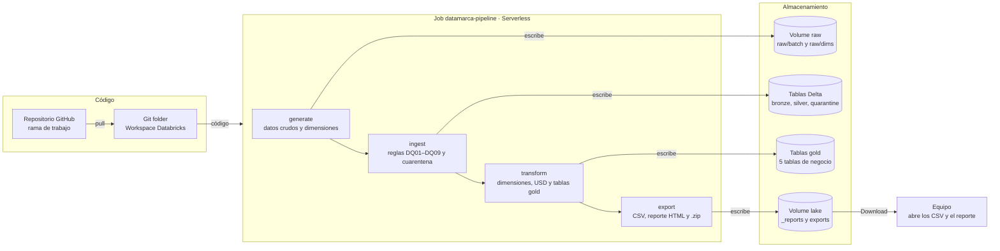

# DATAMARCA_spark_pipeline

Repositorio para el desarrollo de la Unidad 3: implementación de un pipeline distribuido con Apache Spark para **DATAMARCA S.A.**, cadena de supermercados con operación en Colombia, México y Perú.

---

## 1. Generación de datos sintéticos (`data_generator.py`)

DATAMARCA recibe información transaccional desde tres canales heterogéneos y sin un esquema común entre países. Como no se cuenta con datos reales, el script `data_generator.py` simula esos flujos de forma **reproducible**, en modalidad **batch** o **streaming**, para alimentar el pipeline de Spark.

El generador usa únicamente la librería estándar de Python (no requiere instalar dependencias).

### 1.1 Requisitos y ejecución

- Python 3.10 o superior.

```bash
# Batch: un archivo por canal por cada minuto simulado (120 minutos = 2 horas)
python data_generator.py batch --clean

# Streaming: micro-lotes cada 10 s simulados, a 60x la velocidad real (~2 min reales)
python data_generator.py stream --clean --speed 60
```

| Parámetro | Valor por defecto | Descripción |
|---|---|---|
| `--seed` | `42` | Semilla aleatoria. La misma semilla produce exactamente los mismos datos. |
| `--start` | `2026-10-26T13:00:00Z` | Inicio de la simulación en UTC (08:00 en Bogotá y Lima, 07:00 en Ciudad de México). |
| `--minutes` | `120` | Minutos simulados (2 horas). |
| `--tx-per-minute` | `2000` | Transacciones promedio por minuto. |
| `--dirty-rate` | `0.02` | Proporción de transacciones con un defecto de calidad inyectado. |
| `--late-scale` | `1.0` | Multiplicador de la probabilidad de llegada tardía. |
| `--out` | `data/batch` o `data/stream` | Carpeta de salida. |
| `--clean` | — | Borra la carpeta de salida antes de escribir. |
| `--quiet` | — | No imprime el resumen de cada ventana. |
| `--interval` (solo stream) | `10` | Segundos simulados por micro-lote (debe dividir 60). |
| `--speed` (solo stream) | `60` | Aceleración: `1` = tiempo real (2 h), `60` = 1 minuto simulado por segundo real, `0` = sin esperas. |

También puede usarse como módulo desde otro archivo de Python:

```python
from data_generator import DataGenerator

gen = DataGenerator(seed=42)

for ventana in gen.iter_batches():          # una ventana por minuto (~2000 tx)
    ventana.records["POS"]                  # lista de dict (filas)
    ventana.records["ECOMMERCE"]            # lista de dict (eventos anidados)
    ventana.records["LOYALTY_APP"]

for ventana in gen.iter_stream(10):         # micro-lotes de 10 s (~333 tx)
    ...

for canal, registro in gen.iter_events():   # evento a evento, p. ej. para Kafka
    ...
```

### 1.2 Fuentes simuladas

| Canal | Formato | Granularidad | Sistema origen |
|---|---|---|---|
| **POS** (tiendas físicas) | CSV con encabezado | Una fila por línea de producto | `POS-NCR-CO`, `POS-SAP-MX`, `POS-ORACLE-PE` |
| **E-commerce** | JSON Lines | Un evento `ORDER_PLACED` anidado por pedido | `ECOM-VTEX` |
| **App de fidelización** | JSON Lines | Un evento `SCAN_AND_GO_PURCHASE` por compra | `LOYALTY-APP-ANDROID` / `LOYALTY-APP-IOS` |

Esto cubre los formatos que pide la guía: registros tabulares CSV y logs semiestructurados JSON. El POS es plano (una fila por producto); los canales digitales traen los productos anidados en un arreglo `items`, por lo que el pipeline debe aplanarlos (`explode`) para unificarlos con el POS.

### 1.3 Campos relevantes para el pipeline

Todos los registros incluyen:

| Campo | Propósito |
|---|---|
| `source_channel`, `source_system` | Origen del dato (canal y sistema que lo produjo). |
| `country_code` | País (`CO`, `MX`, `PE`). Columna candidata de partición. |
| `event_ts_utc` | Momento en que ocurrió la transacción (tiempo de evento, en UTC). Base para ventanas y *watermarks*. |
| `event_ts_local` | El mismo instante en la hora local del país, con su desfase (`-05:00` / `-06:00`). |
| `emitted_ts_utc` | Momento simulado en que la fuente envió el registro. La diferencia con `event_ts_utc` es la latencia. |
| `event_date`, `event_hour` | Fecha y hora UTC del evento, precalculadas para particionar. |
| `batch_id` | Lote o micro-lote en el que llegó el registro (`B-AAAAMMDD-HHMM` o `S-AAAAMMDD-HHMMSS`). |
| `schema_version` | Versión del esquema de la fuente (`1.0`). |

**Estrategia de partición sugerida:** `country_code` / `event_date` (y opcionalmente `source_channel` o `event_hour`). Así las consultas de inventario por país y día aprovechan el *partition pruning* de Spark.

Otros campos de negocio: `transaction_id` / `order_id`, `store_id`, `city`, `warehouse_id` (CEDI que abastece la tienda), `customer_id`, `loyalty_id`, `sku`, `product_name`, `category`, `unit_of_measure`, `quantity`, `unit_price`, `discount_amount`, `tax_amount`, `line_total`, `currency`, `payment_method`, y por canal: `terminal_id` y `cashier_id` (POS); `session_id`, `device`, `fulfillment.delivery_type` (e-commerce); `member.tier` y `points` (fidelización).

### 1.4 Estructura de salida

```
data/
├── batch/
│   ├── _manifest.jsonl
│   ├── pos/ingest_date=2026-10-26/pos_20261026_1300.csv
│   ├── ecommerce/ingest_date=2026-10-26/ecommerce_20261026_1300.jsonl
│   └── loyalty/ingest_date=2026-10-26/loyalty_20261026_1300.jsonl
└── stream/
    ├── _manifest.jsonl
    ├── pos/part-000000-20261026T130000.csv
    ├── ecommerce/part-000000-20261026T130000.jsonl
    └── loyalty/part-000000-20261026T130000.jsonl
```

- En batch, las carpetas `ingest_date=...` usan el formato Hive, por lo que Spark agrega `ingest_date` como columna al leerlas.
- En streaming, cada archivo se escribe primero con un nombre oculto temporal y luego se renombra de forma atómica. Así Spark Structured Streaming (fuente de archivos) nunca lee un archivo a medio escribir.
- `_manifest.jsonl` registra por ventana: número de transacciones por canal, número de registros, llegadas tardías y defectos inyectados por tipo. Sirve como "respuesta esperada" para verificar las validaciones de calidad del pipeline.
- Una corrida completa ocupa unos 300 MB por modalidad. La carpeta `data/` está en `.gitignore` (solo se versiona `data/.gitkeep`); los datos se regeneran con el script.

### 1.5 Cómo funciona

1. **Generación por minuto.** Para cada minuto simulado se crea un generador aleatorio propio con semilla derivada de `(seed, minuto)`. Se generan ~2000 transacciones (distribución normal con desviación del 5 %), con tiempos de evento uniformes dentro del minuto.
2. **Construcción de la transacción.** Para cada una se elige canal, país, tienda, cliente, canasta de productos, precios, descuentos, impuestos y medio de pago, y luego se da el formato propio de su canal (fila CSV o evento JSON).
3. **Latencia de envío.** A cada transacción se le asigna un momento de emisión: normalmente unos segundos después del evento, o varios minutos después si es una llegada tardía.
4. **Entrega por ventanas.** Las transacciones se ordenan por momento de emisión y se entregan en ventanas: de 60 s en batch y de `--interval` segundos en streaming. Un registro tardío aparece en la ventana en la que *llega*, no en la que *ocurrió*, igual que en un sistema real.
5. **Reproducibilidad.** Como cada minuto tiene su propia semilla, batch y streaming generan **exactamente las mismas transacciones** (240 056 con la semilla 42); solo cambia el tamaño de la ventana de entrega. Dos ejecuciones con la misma semilla producen archivos idénticos.

Después de los 120 minutos aparecen algunas ventanas adicionales casi vacías: corresponden a registros tardíos que siguen llegando (en batch resultan 134 ventanas en lugar de 120).

---

## 2. Supuestos de la simulación

### 2.1 Volumen

- ~**2000 transacciones por minuto** en total (todos los canales y países), equivalente a ~33 por segundo.
- En streaming el volumen es proporcional: ~333 transacciones por micro-lote de 10 s.
- El volumen es constante durante las 2 horas (no se modelan horas pico).
- Una transacción del POS genera tantas filas como productos tenga la canasta (en promedio ~3), por lo que hay más filas que transacciones.

### 2.2 Distribución por canal y país

| Canal | Participación | | País | Participación |
|---|---|---|---|---|
| POS | 65 % | | México | 45 % |
| E-commerce | 25 % | | Colombia | 35 % |
| App de fidelización | 10 % | | Perú | 20 % |

### 2.3 Parámetros por país

| País | Moneda | Zona horaria | Impuesto | Tasa de cambio (por USD) | Ciudades (n.º de tiendas) | Medios de pago locales |
|---|---|---|---|---|---|---|
| Colombia | COP | UTC-5 | IVA 19 % | 4000 | Bogotá (12), Medellín (7), Cali (5), Barranquilla (4) | Nequi, Daviplata |
| México | MXN | UTC-6 | IVA 16 % | 18 | CDMX (14), Guadalajara (7), Monterrey (7), Puebla (4) | SPEI, CoDi |
| Perú | PEN | UTC-5 | IGV 18 % | 3.7 | Lima (12), Arequipa (4), Trujillo (3) | Yape, Plin |

- Cada ciudad tiene un centro de distribución (`CEDI-<país>-<ciudad>`) que abastece sus tiendas.
- Las zonas horarias son fijas (ninguno de los tres países aplica horario de verano).
- Todos los países usan las mismas columnas dentro de cada canal. La heterogeneidad entre países está en moneda, impuestos, hora local, sistema POS de origen y medios de pago.

### 2.4 Catálogo y precios

- 39 productos en 9 categorías: abarrotes, lácteos, frutas y verduras, carnes, bebidas, aseo, panadería, cuidado personal y mascotas.
- Cada producto tiene un precio base en USD que se convierte a moneda local con una variación aleatoria de ±5 % y se redondea a un múltiplo realista (50 COP, 0.50 MXN, 0.10 PEN).
- Frutas, verduras y carnes se venden por kilogramo (cantidades decimales); el resto por unidad.
- Los precios **incluyen impuestos**; `tax_amount` es el impuesto contenido en el total de la línea.
- El 15 % de las líneas tiene un descuento promocional del 5 % al 30 %.
- Tamaño de canasta: POS 1–8 productos, e-commerce 2–12, app 1–5.

### 2.5 Clientes

- 50 000 clientes por país; el 60 % está inscrito en el programa de fidelización.
- En el POS, el 55 % de las compras identifica al cliente; el resto son anónimas (`customer_id` vacío, lo cual es válido y **no** es un error).
- En la app de fidelización todas las compras son de clientes inscritos, con nivel (`BRONZE`, `SILVER`, `GOLD`, `PLATINUM`) y puntos ganados (1 punto por cada 1000 COP, 10 MXN o 3 PEN).

### 2.6 Latencia y datos tardíos

| Canal | Latencia normal (promedio) | Probabilidad de llegada tardía | Retraso tardío | Causa simulada |
|---|---|---|---|---|
| POS | 3 s | 3 % | 2 – 15 min | Tiendas que sincronizan un buffer local tras perder conexión |
| E-commerce | 0.8 s | 0.5 % | 1 – 5 min | Reintentos del servidor |
| App de fidelización | 2 s | 2 % | 1 – 15 min | Celulares sin señal que sincronizan después |

En total ~2.3 % de las transacciones llega tarde. Esto permite evidenciar el manejo de *late data* con *watermarks* en el modo streaming.

### 2.7 Defectos de calidad inyectados

Aproximadamente el **2 %** de las transacciones tiene un defecto, para que las validaciones de ingestión tengan algo que detectar:

| Defecto | Peso | Qué ocurre |
|---|---|---|
| `missing_required` | 25 % | Falta un campo obligatorio: `store_id` (POS), `warehouse_id` (e-commerce) o `loyalty_id` (app). |
| `duplicate` | 20 % | La misma transacción se reenvía entre 1 y 90 s después (mismo ID). |
| `negative_quantity` | 15 % | La primera línea tiene cantidad negativa. |
| `amount_mismatch` | 15 % | El `line_total` de la primera línea está multiplicado por 10 y no cuadra con cantidad × precio − descuento. |
| `invalid_country` | 10 % | Código de país en minúscula (`co`), de 3 letras (`COL`) o vacío. |
| `future_event_ts` | 8 % | El tiempo del evento está entre 1 y 30 días en el futuro. |
| `malformed` | 7 % | La línea del archivo está truncada (CSV con columnas faltantes o JSON inválido). Solo ocurre al escribir archivos. |

Los defectos no se marcan en los datos (el pipeline debe detectarlos por su cuenta); el conteo esperado por ventana está en `_manifest.jsonl`.

---

## 3. Guía de replicación en Databricks

### 3.1 Objetivo y resumen

Con esta guía cualquier integrante del equipo puede ejecutar el pipeline de DATAMARCA en Databricks Free Edition en unos 30 minutos, sin instalar nada en su computador. Un solo job serverless genera los datos, los valida, construye las tablas analíticas y exporta los resultados a CSV y a un reporte HTML.

El pipeline tiene cuatro etapas:

1. **generate**: `data_generator.py` crea 2 horas simuladas de transacciones (unas 240 000) de POS (CSV), e-commerce y app de fidelización (JSON), con defectos de calidad inyectados.
2. **ingest**: lee las tres fuentes, aplica las reglas de calidad DQ01–DQ09 y escribe las capas bronze, silver y quarantine.
3. **transform**: une silver con las dimensiones, convierte montos a USD y construye las tablas gold.
4. **export**: `export_results.py` guarda las tablas gold y los reportes de calidad como CSV y genera un reporte HTML para compartir.

**Requisitos previos**

- Una cuenta de [Databricks Free Edition](https://www.databricks.com/learn/free-edition) (gratuita, solo correo).
- Acceso de lectura al repositorio [LozantMat/DATAMARCA_spark_pipeline](https://github.com/LozantMat/DATAMARCA_spark_pipeline).
- La rama `feature/databricks-serverless`, mientras no se haya fusionado en `main`.

### 3.2 Arquitectura en Databricks

Todo vive en el esquema `workspace.datamarca`: dos Volumes para archivos y las tablas Delta de cada capa en Unity Catalog.



Cada etapa lee lo que escribió la anterior: ingest lee el Volume `raw`, transform lee silver y quarantine, y export lee las tablas gold y los reportes JSON. Las etapas generate, ingest y transform son la tarea `pipeline` (`pipeline.py`); export es una segunda tarea (`export_results.py`) que corre cuando la primera termina bien.

### 3.3 Paso a paso de configuración

La configuración se hace una sola vez y toma unos 15 minutos.

1. **Crear la cuenta.** Regístrese en Databricks Free Edition. El workspace ya trae el catálogo `workspace` y cómputo serverless; no hay que crear clústeres.
2. **Crear el esquema y los volúmenes.** Abra *SQL Editor* y ejecute:

   ```sql
   CREATE SCHEMA IF NOT EXISTS workspace.datamarca;
   CREATE VOLUME IF NOT EXISTS workspace.datamarca.raw;
   CREATE VOLUME IF NOT EXISTS workspace.datamarca.lake;
   ```

3. **Conectar el repositorio.** Vaya a *Workspace → Create → Git folder* y pegue `https://github.com/LozantMat/DATAMARCA_spark_pipeline`. Si el repositorio es privado, primero agregue un token de GitHub en *Settings → Linked accounts*.
4. **Elegir la rama.** En la Git folder, haga clic en el nombre de la rama (arriba), seleccione `feature/databricks-serverless` y haga *Pull*. Cuando la rama se fusione, use `main`.
5. **Crear el job.** Vaya a *Jobs & Pipelines → Create job* y nómbrelo `datamarca-pipeline`.
6. **Tarea 1, `pipeline`.** Tipo **Python script**, fuente **Workspace**, archivo `pipeline.py` de la Git folder, cómputo **Serverless**. Parámetros:

   ```json
   ["--input", "/Volumes/workspace/datamarca/raw/batch",
    "--dims", "/Volumes/workspace/datamarca/raw/dims",
    "--lake", "/Volumes/workspace/datamarca/lake",
    "--tables", "workspace.datamarca",
    "--overwrite-generated"]
   ```

7. **Tarea 2, `export`.** Haga clic en *Add task*, tipo **Python script**, archivo `export_results.py`, cómputo **Serverless**, *Depends on* = `pipeline`. Parámetros:

   ```json
   ["--lake", "/Volumes/workspace/datamarca/lake",
    "--tables", "workspace.datamarca",
    "--sep", ";"]
   ```

| Parámetro | Qué controla |
| --- | --- |
| `--input` | Carpeta donde `generate` escribe los datos crudos y de donde `ingest` los lee |
| `--dims` | Carpeta de las dimensiones (países, tiendas, productos) |
| `--lake` | Volume donde quedan los reportes JSON (`_reports`) y las exportaciones (`exports`) |
| `--tables` | Catálogo y esquema donde se crean las tablas Delta |
| `--overwrite-generated` | Permite regenerar los datos si `raw/batch` ya tiene archivos |
| `--sep` | Separador de los CSV: `;` para Excel en español, `,` para pandas o Power BI |

No se necesitan variables de entorno ni credenciales: el job usa la identidad de quien lo ejecuta.

### 3.4 Ejecución y verificación

Una corrida completa tomó 376 s en la primera ejecución (30 de octubre de 2026) y todas las reglas de calidad detectaron el 100 % de los defectos inyectados.

1. En el job, haga clic en **Run now**. La corrida termina en verde cuando las dos tareas terminan bien.
2. Abra la tarea `pipeline`. Al final de la salida debe aparecer `Pipeline SUCCESS` con las tres etapas en `OK`, la tabla de calidad con recall 1.0 y las cuatro verificaciones de reconciliación en `[OK]`.
3. Confirme que se crearon las 9 tablas:

   ```sql
   SHOW TABLES IN workspace.datamarca;
   ```

4. Consultas de evidencia para el informe:

   ```sql
   SELECT * FROM workspace.datamarca.gold_daily_sales ORDER BY sales_usd DESC;
   SELECT dq_rule, dq_rule_name, SUM(lines) AS lineas
   FROM workspace.datamarca.gold_dq_daily_rejections GROUP BY ALL;
   DESCRIBE HISTORY workspace.datamarca.silver_fact_sales_lines;  -- versiones Delta
   EXPLAIN SELECT SUM(line_total_usd) FROM workspace.datamarca.silver_fact_sales_lines
   WHERE country_code = 'CO';  -- PartitionFilters = poda de particiones
   ```

| Tabla | Capa | Contenido |
| --- | --- | --- |
| `bronze_sales_lines` | bronze | Todas las líneas leídas, con metadatos de ingesta |
| `silver_sales_lines` | silver | Líneas válidas y deduplicadas, particionadas por país y fecha |
| `quarantine_sales_lines` | quarantine | Líneas rechazadas y la regla que fallaron |
| `silver_fact_sales_lines` | silver | Hechos unidos a dimensiones, montos en USD y hora local |
| `gold_daily_sales` | gold | Ventas por país, día local, canal y categoría |
| `gold_hourly_sales` | gold | Ventas por país, día y hora local, canal |
| `gold_store_daily_kpis` | gold | Tickets, ventas y ticket promedio por tienda y día |
| `gold_warehouse_daily_demand` | gold | Demanda por CEDI, día y SKU |
| `gold_dq_daily_rejections` | gold | Líneas rechazadas por regla, canal y día |

**Tiempos de referencia (volumen 1x, 240 056 transacciones)**

| Etapa | Duración (s) |
| --- | --- |
| generate | 154 |
| ingest | 170 |
| transform | 51 |
| Total | 376 |

El paso más lento es el reporte de calidad dentro de ingest (63 s): sin caché, serverless vuelve a leer los archivos crudos para cada verificación. El Spark UI no existe en serverless; el plan y los tiempos de cada consulta se ven en el *query profile*.

### 3.5 Exportar y compartir los resultados

La tarea `export` deja todo en un solo `.zip` que se descarga desde Databricks y se comparte con el equipo. Toma la última ejecución exitosa y escribe en `/Volumes/workspace/datamarca/lake/exports/<run_id>/`:

| Archivo | Contenido |
| --- | --- |
| `01_resumen_ejecucion.csv` | Estado, duración por etapa, conteos de líneas, tasa de rechazo y ventas totales |
| `02_tiempos_por_etapa.csv` | Segundos de cada paso de ingest y transform |
| `03_calidad_reglas.csv` | DQ01–DQ07: inyectadas, detectadas, recall y precisión |
| `04_reconciliacion.csv` | Las cuatro verificaciones de la capa gold |
| `gold_*.csv` | Las cinco tablas gold completas |
| `reporte_datamarca_<run_id>.html` | Reporte con KPIs, gráficas y tablas; se abre en cualquier navegador |
| `datamarca_resultados_<run_id>.zip` | Todo lo anterior en un archivo |
| `LEEME.txt` | Qué contiene cada archivo |

**Cómo descargarlos**

1. Vaya a *Catalog → workspace → datamarca → Volumes → lake → exports* y abra la carpeta del `run_id` más reciente.
2. Seleccione `datamarca_resultados_<run_id>.zip` y haga clic en **Download**.
3. Suba el `.zip` a la carpeta compartida del equipo. El HTML funciona sin conexión y sin Databricks.

**Notas para el análisis**

- Los CSV están en UTF-8 con BOM, así que las tildes se ven bien en Excel.
- Con `--sep ";"` Excel en español separa las columnas solo; para pandas o Power BI use `--sep ","`.
- Los montos `*_usd` están en dólares; los `*_local`, en la moneda de cada país (COP, MXN, PEN).
- Para exportar una ejecución anterior, agregue `"--run-id", "<run_id>"` a los parámetros de la tarea.
- También se puede correr fuera de Databricks: `python export_results.py --lake lake`.

### 3.6 Adaptaciones para serverless y problemas comunes

El mismo código corre en local, en Dataproc y en Databricks: detecta Databricks por la variable `DATABRICKS_RUNTIME_VERSION` y solo ahí cambia de comportamiento.

| Restricción de serverless | Cómo la resuelve el código |
| --- | --- |
| No existe `spark.sparkContext` ni acceso a la JVM | `_contract.json` y `_truth.jsonl` se leen con Python; los Volumes son rutas locales |
| No se permite `cache()` | `materialize()` y `release()` no hacen nada en Databricks; por eso algunos pasos se recalculan |
| Solo se pueden fijar algunas configuraciones de Spark | Se usa la sesión existente y solo se fijan la zona horaria (UTC) y las particiones de shuffle |
| No se puede desactivar `spark.sql.csv.parser.columnPruning.enabled` | DQ01 también marca como corrupta toda fila CSV con `schema_version` vacío: una fila truncada siempre pierde su última columna |
| Unity Catalog no crea tablas sobre Volumes | Las capas se guardan como tablas Delta `<capa>_<nombre>`; los reportes JSON y los CSV van al Volume `lake` |
| `sys.exit(0)` marca la tarea como fallida | El script solo llama a `sys.exit` cuando algo falló |

| Síntoma | Causa | Solución |
| --- | --- | --- |
| `TABLE_OR_VIEW_NOT_FOUND` al consultar `gold_*` | El job no ha terminado, falló o usó otra rama | Revise la última corrida en *Runs*; confirme la rama de la Git folder y vuelva a correr |
| `unrecognized arguments: --tables` | La Git folder está en `main` sin la adaptación | Cambie a `feature/databricks-serverless` y haga *Pull* |
| No aparece la carpeta `exports` ni el `.zip` | La tarea `export` no se agregó, no ha corrido o falló | Revise la salida de la tarea `export`; debe terminar con la lista de archivos. `LIST '/Volumes/workspace/datamarca/lake/exports'` muestra lo que existe |
| `The generation destination ... is not empty` | `raw/batch` ya tiene datos | Agregue `--overwrite-generated`, o use `--stages ingest transform` para reutilizarlos |
| La corrida dice *Workload failed* pero la salida termina en `Pipeline SUCCESS` | Versión anterior con `sys.exit(0)` | Haga *Pull* de la rama (commit `fix(pipeline)`) |
| `GATE_FAILED: quarantine rate ...` | Más del 5 % de las líneas fue rechazado | Revise los datos de entrada o ajuste `--max-reject-rate` |
| El cómputo se apaga por el resto del día | Se superó la cuota de uso justo de Free Edition | Espere al día siguiente; los datos no se borran |

### 3.7 Pruebas de volumen y costo

Para medir cómo crece el tiempo con el volumen, repita la corrida con 2x y 4x los datos usando *Run now with different parameters* en la tarea `pipeline`.

1. Agregue `"--scale", "2"` y cambie `--input` a `/Volumes/workspace/datamarca/raw/batch_x2`. Repita con `"--scale", "4"` y `batch_x4`.
2. Cada corrida reescribe las tablas y deja su propio reporte en `lake/_reports`, así que las tres mediciones se conservan.
3. Exporte cada una con la tarea `export` y `"--run-id", "<run_id>"`; los tiempos quedan en `02_tiempos_por_etapa.csv`.
4. Registre los resultados:

| Volumen | Transacciones | ingest (s) | transform (s) | Total (s) |
| --- | --- | --- | --- | --- |
| 1x | 240 056 | 170 | 51 | 376 |
| 2x |  |  |  |  |
| 4x |  |  |  |  |

**Costo:** Free Edition no cobra, así que el costo del informe es una estimación. Multiplique la duración de cada corrida por la tarifa de *Jobs Serverless* que publica Databricks en su [página de precios](https://www.databricks.com/product/pricing) para la nube que se elija, y compárelo con la estimación de Dataproc Serverless que calcula `benchmark.py`.

Haga las pruebas de volumen con tiempo: si se supera la cuota diaria de Free Edition, el cómputo se detiene hasta el día siguiente.
